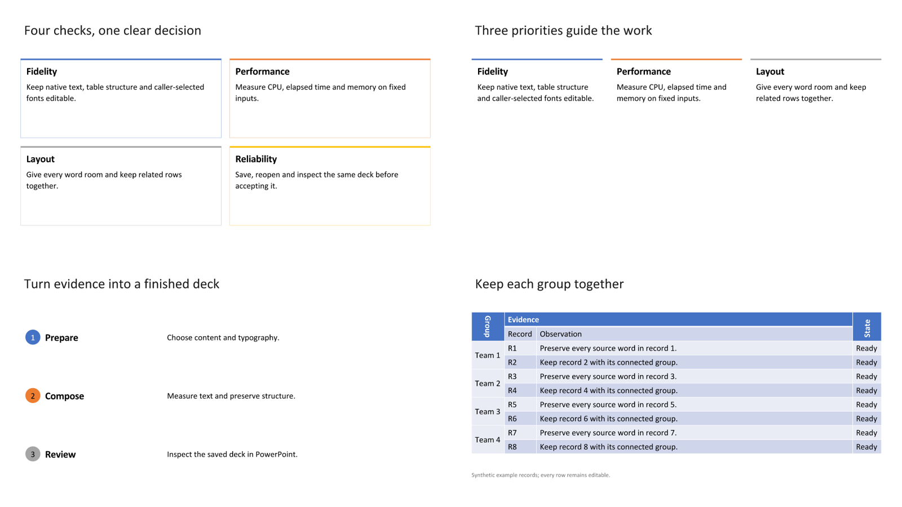

# Generated layout and table integration — October 17, 2026

This expands the normal Lectern generation path from 20 to 23 layouts and exposes
existing native table capabilities in DeckIR. See the [usage guide](GENERATED-LAYOUTS.md)
for the content contract and `Lectern/scripts/test-layouts.sh` for an offline
post-pull review. Rostrum/RostrumLayout remain pure Swift with zero dependencies;
LecternIR remains Foundation-only. Callers retain their font choices.

## Scope

- Editable cards, three-column panels and numbered steps use measured complete
  headings/details. They refuse oversized content before writing their shapes.
- Optional additional table headers, rectangular merges and quarter-turn directions
  survive the provider schema, validation, page splitting, saved snapshots, recovery
  and saved-deck read-back. Covered cells cannot contain discarded text.
- The Lab and production regression runner share one synthetic fixture. Template
  rendering retains the supplied master/layout/theme and fits an object region.
- Plain input retains its prior saved decks, geometry, SVG previews and diagnostics.

This does not implement general complex-script text, table autofit, stacked text,
new chart types or automatic pagination of panel compositions. An older DeckIR
consumer must adopt the new fields before rendering them correctly.

## Verification

Focused coverage includes malformed/hostile table coordinates, header boundaries,
overlap and covered text; full-grid to page-local remapping; fixed panel count and
complete-text refusal; notes/sources; deterministic saving; recovery of each new
composition; unchanged neighboring parts; saved Inspect previews/diagnostics and
text export. The Lab runs both 16:9 and 4:3. Native directions are deliberately
removed in a regression to verify that saved-content checking detects the loss.

The normal Release post-pull script produced two six-slide decks using exact
caller-supplied Calibri faces in private review templates. Both have zero schema,
missing-font or dropped-content issues. Independent python-pptx and ZIP/XML checks
confirm all shapes are within the canvas, the 16 body records occur in order,
connected pairs stay together, and both header rows/merges/directions repeat on
the two table pages. [Exact deck hashes and page contents](benchmarks/2026-10-17-generated-layouts-review.json)
are retained. Proprietary font bytes and private templates remain outside Git.

Portable raster contact sheets were inspected in both ratios with resvg and the
exact Calibri faces. SVG embedded aliases were explicitly mapped to those faces
for this check because resvg ignores CSS data-font declarations. Original SVGs
and PPTX were unchanged. The Debug and normal Release PPTX/SVG/diagnostic outputs
are identical in both ratios. **New PowerPoint slide-view/PDF acceptance remains open**;
prior acceptance of another table pack does not qualify these compositions.

Portable previews (not native acceptance):

[4:3 contact sheet](benchmarks/2026-10-17-generated-layouts-4x3.png).

The complete `scripts/verify.sh --fast` gate passed: 1,413 root tests, 118
optimized checks and 362 LecternCore tests, including the corrected complete Lab
catalog. Portable native-pack/fidelity checks and both executable README examples
also pass. macOS/iOS app builds are delegated to required Apple PR checks;
app-hosted test execution and live PowerPoint review remain separate.

## Performance controls

Baseline: `4af22a1886a39d2fc0673fd46fa88783fcf85cb3`. Both executables were built
with normal Swift 6.1.3 Release settings, then retained separately with their
SwiftPM resources. The later optimized test gate uses testability and is not the
source of these measurements. The candidate source/binary hashes, input hashes,
all samples and stage timings are retained in the raw records.

The [collector](benchmarks/2026-10-17-generated-layouts.py) uses the native
[wait4 launcher](benchmarks/2026-10-16-measure-child.c), process CPU and per-child
peak RSS. Elapsed includes launcher/process startup and file writes. Linux CPU
affinity is pinned; no builds/tests run concurrently with the collector. Each case
has one warmup pair followed by seven alternating-order measured pairs. These are
four unchanged production-renderer controls: a mixed 13-slide deck, 8-row plain
table, 100-row plain table, and an 8-row template-backed table.

[Single-render raw record](benchmarks/2026-10-17-generated-layouts-single.json.gz).
Median paired candidate/baseline changes (negative means lower):

| Control | Process CPU | Elapsed | Peak RSS |
| --- | ---: | ---: | ---: |
| Mixed | −4.05% | −3.56% | +0.31% |
| Small table | −1.34% | +2.55% | +0.08% |
| Large table | −5.19% | −5.53% | +0.20% |
| Template table | −4.23% | −3.85% | −0.21% |

These short samples are noisy. Separate variant medians disagree with some paired
summaries: small-table CPU is 85.60 → 102.27 ms and elapsed 96.41 → 129.57 ms;
template CPU is 409.34 → 437.76 ms. Do not interpret this table as a speedup claim.
The longer-batch follow-up below retains this initial adverse evidence.

All 45 canonical artifacts match in every single-render pair: 17 mixed, 6 small,
15 large and 7 template. Canonicalization removes only run-directory/UUID/timing
fields in the existing composition harness. PPTX/SVG/diagnostic bytes and saved
content remain exact, retaining column widths, row heights and page boundaries.

### Longer batches

The [batched raw record](benchmarks/2026-10-17-generated-layouts-batch.json.gz)
retains ten renders per process with the same one warmup/seven measured pairs.
Each render creates a fresh renderer/deck; the batch amortizes startup and has
its own process-level peak RSS. All **450** canonical artifacts match in every
pair. This is a separate workload, not an overwrite of the short samples.

| Control | Paired CPU change | Paired elapsed change | Paired peak RSS change |
| --- | ---: | ---: | ---: |
| Mixed | −0.32% | +0.04% | +0.19% |
| Small table | −1.75% | −1.31% | −0.11% |
| Large table | +0.03% | −0.38% | +0.03% |
| Template table | +2.19% | +2.34% | +0.23% |

Separate baseline/candidate medians, in milliseconds except memory:

| Control | CPU | Elapsed | Peak RSS (KiB) |
| --- | --- | --- | --- |
| Mixed | 2389.33 → 2335.53 | 2578.66 → 2514.62 | 33804 → 33860 |
| Small table | 477.76 → 472.21 | 540.93 → 533.85 | 29620 → 29532 |
| Large table | 2738.47 → 2786.49 | 2906.95 → 2956.46 | 32604 → 32596 |
| Template table | 3425.23 → 3535.61 | 3527.87 → 3629.45 | 47560 → 47524 |

The template control retains a small whole-process cost. Its paired table-plan,
composition and save CPU medians do not increase; the record does not establish
a new algorithmic hotspot. This work makes **no general speedup, memory reduction
or native Mac performance claim**. Both favorable and adverse samples remain.

### New workload cost

The [new-workload collector](benchmarks/2026-10-17-generated-layouts-new.py) and
[raw record](benchmarks/2026-10-17-generated-layouts-new.json.gz) retain one warmup
and seven fresh processes, each producing both six-slide review decks with the
exact embedded faces. Median process CPU is **830.94 ms**, elapsed **865.36 ms**,
and peak RSS **49,540 KiB** (48.38 MiB). CPU ranges 822.28–895.02 ms; elapsed
854.42–933.72 ms; RSS 49,372–50,088 KiB. All 20 canonical new-workload artifacts
match between processes. These are absolute Linux measurements, not comparisons
to an older renderer that lacks the new content vocabulary.

### Reproduction

Retain each revision's `swift build -c release --package-path Lectern --product
CompositionRegression` executable and its SwiftPM resource bundles under
`SCRATCH/baseline` and `SCRATCH/candidate`. Supply the hash-matching private
`SCRATCH/font-templates/Calibri-4x3.potx` (another template is a different workload).
Run the collector with the repository and scratch paths; an optional third
argument controls renders per process. Its two plain-table JSON inputs are
synthetic and generated locally. The first comparison uses one render per
process; each batched render still creates its own renderer and fresh deck.

Raw timing records are losslessly gzip-compressed; for example, read the batch record with
`gzip -dc docs/benchmarks/2026-10-17-generated-layouts-batch.json.gz`.
