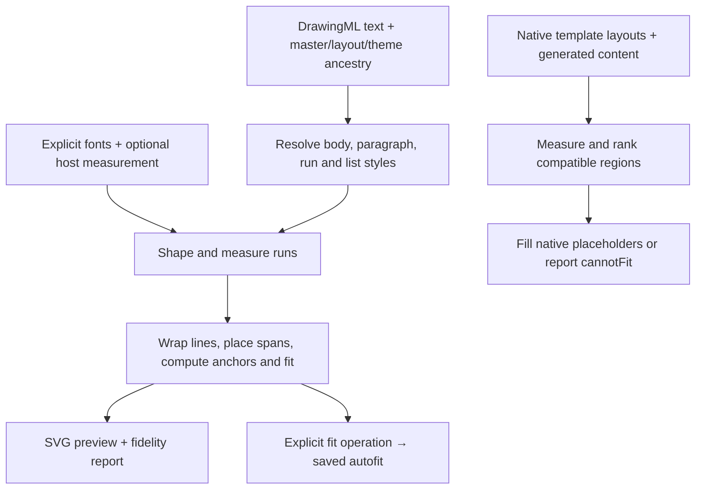
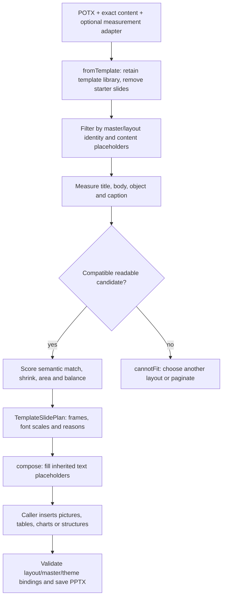

# RostrumLayout and shared text layout

Rostrum separates document layout from slide composition. The shared text engine
measures existing DrawingML for fitting and previews. The `RostrumLayout` product
chooses and fills native template regions or finishes slides authored from a
design system. Neither is a replacement for PowerPoint's complete layout engine.

Version 1.0 ships `RostrumLayout` as a separate SwiftPM product. Add both products
to a composing application and `import RostrumLayout` alongside `import Rostrum`.
The [getting-started guide](GETTING-STARTED.md) includes a complete manifest and
native-template example. Read this guide with the
[preview guide](IMPORTING-AND-PREVIEWING.md), [format support matrix](FORMAT_SUPPORT.md)
and [conformance record](CONFORMANCE.md).

## Components and responsibilities

| Component | Responsibility | Mutation boundary |
| --- | --- | --- |
| `RichTextLayout` in `Rostrum` | Resolve inherited rich text, shape and measure runs, break lines, place spans and compute occupied height and fit | Read-only geometry and diagnostics |
| `FontLibrary`, `FontMetrics`, `TextShaper` | Explicit face registration, advances and bounded shaping; optional host measurement and measured preview fallback | Registration changes the host's font registry, not source typeface names |
| `shape.fitText(fonts:)` | Use shared rich-text geometry to compute saved normal autofit | Explicit editing operation; writes computed fit settings |
| `SVGRenderer` | Draw resolved content using text geometry and collect fidelity issues | Read-only preview; does not repair or relayout the saved document |
| `TemplateLayoutEngine` in `RostrumLayout` | Evaluate native layouts, measure content, score compatible candidates and fill placeholders | Composes new slide content; retains the supplied master/layout/theme |
| `TableLayoutEngine` in `RostrumLayout` | Measure native cell styles and rich text at caller-selected column widths | Returns a read-only row plan and cell issues; no shrinking or pagination |
| `AuthoredLayoutEngine` in `RostrumLayout` | Check and fit design-authored text regions, then publish a reusable layout | May adjust authored typography and spacing; not used to rewrite imported templates |
| `StructuredLayout` in `RostrumLayout` | Preflight and compose editable metrics, process, cycle, pyramid, timeline, quadrant and band structures | Adds native shapes and text inside the chosen region |
| `PanelLayout` in `RostrumLayout` | Measure headed cards, three open columns and numbered rows with caller typography | Refuses overflow before writing native text/shapes; [contract](GENERATED-LAYOUTS.md) |
| `MeasuredPaginator` in `RostrumLayout` | Partition ordered content according to a caller's actual fit predicate | Returns partitions without dropping or reordering content |



Template and authored text composition can accept a `TextHeightMeasurer`
supplied by the host, such as Lectern's Apple measurement adapter. Both use shared
rich-text geometry; an optional host callback adds a conservative height check.
Table planning uses the portable geometry and explicitly registered fonts. A computed fit does
not establish that PowerPoint would select the same autofit.

## Choose the right operation

| Input and intent | API | Result |
| --- | --- | --- |
| Inspect an existing slide | `renderSVGReportingProblems(slideAt:)` | SVG plus known fidelity issues; source content is preserved |
| Explicitly fit a text shape | `shape.fitText(fonts:)` | Saved normal-autofit settings computed from shared rich-text layout |
| Start from a `.potx` | `Presentation.fromTemplate(data:)`, then `TemplateLayoutEngine` | New PPTX slides connected to the source template's layouts and masters |
| Finish slides built from a `Design` or `DeckStyle` | `AuthoredLayoutEngine` | Checked/adjusted authored text and optional published native layouts |
| Break ordered content across pages | `MeasuredPaginator` | Fitting partitions; the caller creates slides and retains document context |
| Measure an existing native table | `TableLayoutEngine.plan` | Read-only cell diagnostics, widths and row heights; apply only an accepted plan |
| Compose a new multi-page table | `TemplateTableContent`, `planTablePages`, `composeTablePages` | Measured native cells, fixed widths, repeated headers/captions and source row ranges |

The table planners and the subsequent fitting improvements are post-1.0 changes
on `main`. See [dependency selection](GETTING-STARTED.md#install-with-swift-package-manager)
before copying an example into a project pinned to 1.0.0.

### Native table row planning

```swift
let planner = TableLayoutEngine(presentation: deck)
let plan = try planner.plan(table,
    columnWidths: [.points(160), .points(320)],
    minimumRowHeight: .points(30), maximumHeight: .points(360))
if plan.fits {
    table.columnWidths(plan.columnWidths).rowHeights(plan.rowHeights)
}
```

The planner reads current cell padding, table-region styles, mixed run faces,
paragraph spacing, tabs and breaks using the renderer's table-cell context.
It preserves full-size text: stored table `fontScale` is ignored and diagnosed.
Each cell result includes its row/column, required height, issues and shaping
diagnostics. `fits` checks geometry and the optional total-height limit; callers
must also review diagnostics for unsupported shaping or substituted fonts.
Unsupported geometry that prevents measurement reports a zero required height
and a cell issue. Oversized rejected plans cap the reported total at the measurement
limit; never apply row heights from a non-fitting plan.
Dimensions are bounded to one million points; invalid/ragged grids throw.
Row heights round upward to an integer EMU. Planning does not mutate source XML.

For template composition, supply the cells directly:

```swift
let content = TemplateTableContent(rows: [
    ["Term", "Meaning"], ["Shared geometry", "Measure the cells that will be saved"]
], columnWeights: [1, 2])
let engine = TemplateLayoutEngine(presentation: deck)
let plan = try engine.plan(title: "Vocabulary", columns: [], preferredTypes: ["obj"],
    object: "tbl", objectCaption: "Definitions remain editable.", table: content)
let slide = try engine.compose(plan, title: "Vocabulary", columns: [])
```

`plan.tableLayout` exposes the accepted grid. Composition writes the native table
and rechecks it before creating a slide, so changed fonts or template styles
cannot reuse an overflowing fit. As with other objects, the caller writes the
caption into `plan.captionFrame`; planning reserves its measured height and an
eight-point gap. The native table retains theme/style references. Column weights
default to half equal share and half bounded text-length weight. Existing callers
retain this estimated allocation; measured sizing is an explicit option below.

The existing-table planner supports rectangular grids with horizontal, vertical
and rectangular merged cells, including `tcPr` quarter-turn text (`vert`/`vert270`).
Other vertical writing modes, arbitrary body rotation, multiple text columns, dynamic fields and nonzero stored
line-spacing reduction return explicit issues. The existing-table planner does
not paginate rows, choose native autofit or certify PowerPoint visual equivalence.
The Templates Library Lab demonstrates composition and existing-table planning,
including custom padding, saved-cell fit, caption clearance and SVG preservation.

Repeated identical cells reuse exact-byte text/style measurements within one
operation (64 entries, 256 KiB estimated payload budget). Style resolution uses
one indexed grid and a bounded text-only projection of the renderer's region styles. Template candidate
plans share at most 64 entries/8,192 cell results within one planning call. No
measurement cache survives table edits or font registration between operations.

### Measured table column widths

```swift
let content = TemplateTableContent(rows: rows, columnSizing: .measured(constraints: [
    .init(minimum: .points(40), maximum: .points(120)),
    .init(minimum: .points(200)),
    .init(minimum: .points(55), maximum: .points(140), preferred: .points(75))
]))
let continuation = try engine.planTablePages(title: "Evidence", table: content,
    caption: "Source: original evidence.")
let search = continuation.pages.first?.slide.tableLayout?.columnSearch
```

Both single-slide planning and table continuations accept `.measured()`. It
measures actual wrapped native cells using registered fonts, inherited styles and
padding. Explicit `columnWeights`, or the default text-length weights, seed the
search. Empty constraints use a 24-point minimum per column; otherwise supply
one constraint per column. Minimum and maximum widths are hard bounds; preferred
widths are soft tie-breaks. Invalid or infeasible constraints throw before mutation.
The total always equals the slot width, including integer-EMU residuals.

The bounded local search prefers supported fitting cells, placeable rows, fewer
pages, less total row height, then proximity to preferred widths. A feasible
constrained starting allocation is retained unless a candidate scores better;
equal scores keep the earlier allocation. Hard constraints can force a different
starting allocation from the default heuristic. Fewer pages can take priority
over a smaller sum of row heights. This is not a global optimum or PowerPoint's
native autofit, and text never shrinks to improve the score.

Each search evaluates at most 24 allocations and 32,768 additional cell visits
beyond its starting allocation. Pagination may measure up to four native style
positions per visit. Unchanged column measurements reuse at most 128 entries /
32,768 retained cell results, with no cache surviving the operation. Large grids
may exhaust the search budget early. `columnSearch` reports candidates, additional
and reused cell measurements, and budget exhaustion; `.estimated` leaves it nil.
These are per-search budgets, not a wall-time limit across all template layouts.

Within a search, width-independent native cell inputs reuse at most 8,192 cell
positions / 2 MiB of estimated key payload. Exact body/style bytes isolate
canonically distinct strings and different native band styles. After the first
allocation, changing column widths can reuse up to 1,024 text preparations / 1 MiB
of estimated source-key payload. A search that stops at its starting allocation
does not create those text preparations. Each preparation retains the existing
bounded paragraph/segment caches. Initial glyph shaping and line layout remain
fresh at each width. Complete line-fragment advances can reuse a shared cache
of at most 2,048 entries / 256 KiB of source-text and family-name bytes. Exact
UTF-8 text, requested face/style, effective measurement size, kerning, ligatures
and native rounding policy identify each advance; tracking and positioning
remain outside the cache. Novel fragments still reshape at their actual line
boundaries. Budget exhaustion uses ordinary measurement with identical results.
These limits describe retained entries/payload, not total process memory. See the
[CPU, elapsed-time, memory and exact-output comparison](TABLE-PREPARATION-20261012.md).
The [fragment profiling and reuse record](TABLE-SHAPING-20261013.md) retains the
subsequent merged/unmerged comparison and the measured memory tradeoff.

Single-slide composition freshly measures the accepted widths. Pagination
composition repeats the bounded search with live fonts/styles and verifies the
accepted widths, row heights and page boundaries before inserting any slides.
The common template style is resolved once within that composition call and
reused for tables and captions; a later call resolves current styles again.
See the [composition profile and preservation comparison](TABLE-COMPOSITION-20261017.md).
Measurement has an explicit performance cost; see the
[Release measurements and saved-file evidence](TABLE-COLUMNS-20261012.md).
Shaping diagnostics and native PowerPoint visual acceptance remain separate from
portable fit, including when width search succeeds.

### Rotated table-cell text

Existing cells with `textDirection = .vertical` (90°) or `.vertical270` (270°)
can be measured without changing their text or font size. The planner uses the
same swapped text rectangle and text-relative insets as SVG and cell `fitText`.
Column width limits the rotated block height; row height provides line width.
A bounded search chooses a verified fitting extent without emergency breaks
inside words, then checks it again after
neighboring cells and merged-row constraints determine the final saved height.

Template composition accepts sparse source-grid overrides:

```swift
let content = TemplateTableContent(
    rows: [["Source", "Evidence", "State"], ["R1", "Exact source words", "Ready"]],
    columnWeights: [1, 5, 1],
    columnSizing: .measured(),
    textDirections: [
        .init(row: 0, column: 0, direction: .vertical),
        .init(row: 0, column: 2, direction: .vertical270)
    ])
let pages = try engine.planTablePages(title: "Rotated headers", table: content)
let slides = try engine.composeTablePages(pages)
```

Directions repeat with header rows and follow body anchors to each continuation.
Set an override on a merge's anchor, never a covered cell. Duplicate/outside
coordinates and unsupported directions refuse before adding slides. Omitting
`textDirections` retains the existing horizontal behavior. The public native
cell API still preserves other OOXML directions; the planner explicitly refuses
unsupported stacked/complex vertical writing and nonhorizontal `bodyPr.vert`.

Each rotated style/column trial uses at most 22 layouts to search the inline
extent, plus a final check in the actual saved rectangle. Preparation is reused
within those trials and discarded with the operation. The search retains an
accepted upper extent; it does not promise the shortest possible row or native
PowerPoint autofit equivalence. A too-narrow column, excessive explicit lines,
or a final rectangle that fails the mixed-run recheck yields a non-fitting plan.
See [support, review workflow, and measurements](TABLE-ROTATED-TEXT-20261017.md).

### Vertical and rectangular merges in existing tables

`TableLayoutEngine.plan` also measures a native merge that covers several rows.
Its anchor exposes `rowSpan` and `columnSpan`; `requiredHeight` is the full cell
height, not a per-row contribution. All covered cells have
`isMergeContinuation == true`, zero required height and empty diagnostics.
Their hidden text, formatting and unknown XML remain untouched.

```swift
try table.merge(row: 1, column: 0, rowSpan: 2, columnSpan: 2)
let geometry = try TableLayoutEngine(presentation: deck).plan(table,
    minimumRowHeight: .points(30), maximumHeight: .points(300))
if geometry.fits {
    table.columnWidths(geometry.columnWidths).rowHeights(geometry.rowHeights)
}
```

Ordinary cells and `minimumRowHeight` establish the row minima; saved row heights
are not minima. The planner then processes multi-row anchors in row-major order.
If a merged cell needs more than its rows provide, the deficit is divided equally
among those rows, with leftover EMUs assigned to earlier rows. Rows only grow,
so intersecting merge height requirements remain satisfied. Rotated text is then
rechecked at the final extents. This policy
is deterministic; it does not claim globally minimal height or PowerPoint's native
autofit choices. `maximumHeight` applies after resolving all row-span constraints.

Planning is read-only, and fresh operations observe current fonts, content and
styles. Width trials reuse text measurements but recompute row constraints.
`TemplateTableContent` accepts the same rectangular merges. Pagination keeps
connected body-row groups together; a group must fit with its repeated header.
Vertical merges crossing the repeated header/body boundary require single-slide composition. See
[measurement evidence](TABLE-VERTICAL-SPANS-20261016.md) and
[template composition and pagination](TABLE-ROW-PAGINATION-20261016.md).

### Horizontal merged cells

`TableLayoutEngine.plan` accepts native horizontal merges and measures the
anchor's rich text, padding and resolved style across the sum of its column
widths. `cells` stays in physical row-major order: anchors expose `columnSpan`;
covered cells have `isMergeContinuation == true` and zero height, issues and
diagnostics. Hidden continuation XML is preserved without contributing to visible
layout. Malformed topology throws. Vertical and rectangular spans use the
combined row-area policy described above.

Template content declares spans in source-grid coordinates:

```swift
let content = TemplateTableContent(rows: [
    ["Grouped evidence", "", "State"],
    ["A longer observation spanning two columns", "", "Reviewed"],
    ["Record 2", "Ordinary editable cell", "Ready"]
], columnSizing: .measured(), merges: [
    .init(row: 0, column: 0, rowSpan: 1, columnSpan: 2),
    .init(row: 1, column: 0, rowSpan: 1, columnSpan: 2)
])
let continuation = try engine.planTablePages(title: "Evidence", table: content)
let pages = try engine.composeTablePages(continuation)
```

For `TemplateTableContent`, nonoverlapping, in-bounds rectangles with positive
row/column spans and at least one span greater than one are accepted. Covered
input strings must be exactly empty, including no whitespace; invalid content
fails before slide insertion. Merges wholly inside the header prefix repeat on every page,
and body spans move with their complete connected row group. Vertical merges
across the header/body boundary are supported only by single-slide composition. Native merge
flags are written in one validated batch, retaining the full physical grid.

Measured width trials include every anchored span's combined width in their
column-cache identity. Span width demand is reserved across its columns, favoring
columns with more ordinary text; short columns can still donate width within a
span. Row-height pressure is distributed across participating columns to propose
candidates; actual combined-width
geometry still decides fit and score. Cache, candidate and cell-visit budgets are
unchanged. Preparation and results expire with each operation; later font, text,
style or topology changes receive fresh measurements. See the
[horizontal-span evidence and performance record](TABLE-SPANS-20261012.md).

### Table continuations in templates

```swift
let continuation = try engine.planTablePages(title: "Evidence", table: content,
    caption: "Source: original evidence.")
let pages = try engine.composeTablePages(continuation)
for page in pages { try page.setNotes("Original speaker notes.") }
```

This API accepts `TemplateTableContent`: a rectangular string grid with optional
horizontal, vertical or rectangular merges. `headerRowCount` selects the leading
rows repeated on every slide (default `1`, valid from `1` through `rows.count`). It chooses one compatible layout,
preferring fewer pages and then the existing composition score. Optional
`masterURI` and `layoutURI` restrict selection. Column widths are computed from
the entire input and stay fixed across pages. Full-size row measurements include
the possible band/edge text styles at each page position; a conservative maximum
can leave extra space when a template supplies different font styles per band.
The title and caption repeat on every page. Unlike single-slide `compose`,
`composeTablePages` also writes the caption into its reserved frame.

`continuation.pages` exposes each slide plan and its `bodyRows` range into the
original `content.rows` array, excluding the leading `headerRowCount` rows. Each
page also exposes `headerRowCount`; local rows before that count are the repeated
header, followed by the original source `bodyRows`. Each body row occurs
once in order. Intersecting row spans in different columns connect transitively;
page boundaries and width-search scores use those same indivisible groups. A
header-only table creates one page. A header, body row or connected group too
tall to fit throws without shrinking, splitting or discarding text. A vertical
merge crossing the header/body boundary requires single-slide composition.
Width-search scoring reserves the sum of all header row heights on every page.
A header-only grid emits one page with an empty body range.
Cell diagnostics remain available through each page's `slide.tableLayout`.

For a two-row header with a vertical label and a grouped heading:

```swift
let grouped = TemplateTableContent(
    rows: [["Source", "Evidence", ""],
           ["", "Observation", "State"],
           ["R1", "Exact original observation", "Ready"]],
    columnSizing: .measured(),
    merges: [.init(row: 0, column: 0, rowSpan: 2, columnSpan: 1),
             .init(row: 0, column: 1, rowSpan: 1, columnSpan: 2)],
    headerRowCount: 2)
let groupedPlan = try engine.planTablePages(title: "Evidence", table: grouped)
let groupedSlides = try engine.composeTablePages(groupedPlan)
```

Header count is a pagination policy, not a styling override. DrawingML's native
`firstRow` region still applies only to row zero; additional header rows retain
native whole-table, band and edge styles. Vertical/rectangular header merges keep
the anchor's native style. This API does not manufacture additional header styles.
The conservative band/edge measurement envelope also covers these extra header
rows. Existing callers retain one-row-header behavior and output.

Composition remeasures live fonts/styles and checks all pages before inserting
slides. Changed page boundaries, row heights or reserved frames require a new
plan. Fit rejection leaves the deck unchanged; this is not a transaction for
arbitrary package I/O failures. Measurement is bounded per cell style, and
partitioning visits each row once using integer EMU arithmetic. Plans and
prospective native cells use memory proportional to the input and emitted pages,
including a copy of the repeated header on every page.

Callers attach notes, sections, provenance and recovery identities to the returned
slides using the source row ranges. This API does not paginate existing imported
tables or preserve arbitrary rich cell XML through a plain-string conversion.
Lectern's generation and recovery layer now consumes this API and manages its own
continuation groups, notes, sections and source-note overflow; see the
[production integration record](LECTERN-TABLES-20261013.md). The
Templates Library Lab runs the public API through export, inspection and reopen
for both canvas sizes, including `repeated-headers-output.pptx`. The earlier
Calibri pack has [user-reported native acceptance](POWERPOINT-REVIEW-20261016.md);
new repeated-header examples remain pending native review. See
[repeated-header evidence](TABLE-REPEATED-HEADERS-20261016.md).

### Measurement contract

`TextHeightMeasurer` receives a `TextMeasureRequest`: text, family name, point
size, bold flag, tracking and available width in points. Return the occupied
height in points for that request. Template and authored fitting invoke
the callback on positioned rich-text spans using the body's available width
after insets, and conservatively accounts for a host height larger than the
shared line height. Shared geometry controls line breaking, inherited paragraph
spacing, margins, tabs and bullets. The legacy callback has no italic flag and is not a complete rich-text
shaping adapter. Keep the adapter deterministic and the font environment fixed
while an engine is in use.

Lectern's [adapter](../Lectern/Sources/LecternCore/Rendering/TemplateRendering.swift)
uses CoreText when available. The portable library does not discover installed
fonts or fetch missing resources. With no adapter, it uses registered font
metrics when available and an estimated character-width path otherwise. The
adapter contract measures a single styled text value, so it does not imply the
full DrawingML semantics of `RichTextLayout`. Preserve those different evidence
boundaries when evaluating fit results.

The layout code uses point coordinates around `Rect`/`EMU`; OOXML stores lengths
in EMUs. Construct lengths with `.points(...)` or `.inches(...)` instead of mixing
raw EMU integers with measured point heights.

## Shared text layout

`RichTextLayout` produces positioned lines/spans, `contentHeight`, `fits`,
`truncated` and shaping diagnostics in point coordinates. Resolution combines
local text-body properties with layout/master defaults, then resolves paragraph
levels and run properties. It accounts for insets, mixed sizes and styles,
tracking, explicit breaks, fields, supported tabs, bullets, paragraph spacing,
saved normal autofit, wrapping and vertical anchoring. The default line bound is
4,096; reaching a bound is observable through truncation rather than an
unbounded layout loop.

The imported-fidelity update fixes several interactions:

- Inherit body properties and placeholder list styles; apply all-caps before
  measuring rather than changing only the displayed glyphs.
- Keep empty-paragraph spacing without emitting a marker or advancing numbering.
  Treat bullet font/size alternatives as inheritance choice groups.
- Use the paragraph text face for automatic numbers and the configured bullet
  face for character bullets. Center/right-aligned markers move with their text.
- Separate interline pitch from final occupied height. Exact line spacing no
  longer adds a following-line gap to the final line of an anchored block.
- Keep viewer advances for adjacent unmeasured runs instead of placing each at
  an estimated absolute x coordinate. Explicit tabs, lines and list boundaries
  retain their positioning.
- Allow an explicit registered `previewFallbackFamily` so unavailable-font
  previews use the same face for measuring and drawing. Missing-font diagnostics
  and strict refusal remain; source font names are preserved.

The native acceptance record includes four title anchors improving from 9–13
pixels too high to within 0–1 pixel at 960×540. This scoped result does not certify
all fonts, scripts, line-breaking rules or native text effects.

## Template composition

`TemplateLayoutEngine.plan` filters layouts by requested content, optional master
or layout identity, usable title/body/object/picture placeholders and geometry.
It measures candidate regions before selecting one. Captions reserve measured
space alongside their objects; fixed artwork and other placeholders bound title
flow. A custom cover can use one body placeholder with separate title/subtitle
levels without flattening its source template.

The candidate score considers semantic layout preference, headline hierarchy,
required shrinking, usable content area, column balance and image aspect ratio.
Equal scores retain stable source order. `TemplateSlidePlan.score.reasons`
exposes the decision factors; `variant` selects among the ranked candidates.
Empty canvas is not itself treated as a defect.

Each `LayoutParagraph` is one native paragraph. Embedded LF, CR or CRLF line
endings are written as `a:br` soft breaks (plain-text reads normalize them to
LF), so line spacing applies without accidentally repeating paragraph spacing.
Use separate `LayoutParagraph` values when paragraph spacing is intended.
`fillPlaceholder` follows the same convention. New Rostrum masters explicitly
declare title and body sizes; legacy missing title styles resolve the native
44 pt fallback. Explicit template styles still take precedence.

Template autofit respects the source body's policy. Supported normal autofit
uses a bounded search and readable lower limits; eligible overflow or shape
autofit can grow a slide-local region into available space. `noAutofit` does not
mean that wrapping is forbidden. The engine does not rewrite a master to force
a candidate to fit. If no compatible candidate works, it throws
`LayoutError.cannotFit` with the relevant constraints.

Structured objects inherit the content placeholder's typeface and master palette.
Generated object typography scales with slide height relative to a 540-point
canvas. Tables, charts, diagrams and captions therefore participate in measured
composition rather than consuming arbitrary leftover rectangles.

### Plan, inspect, compose, validate



A plan records the layout and its selected title/body/object/picture slots,
measured text frames and font scales, separate object/caption frames and scoring
reasons. Build and compose with the same title and column content. Planning does
not create a slide; `compose` rechecks the exact text bodies at their planned
frames before creating and filling placeholders. Changed content or inheritance
that no longer fits, missing slots and incompatible column counts throw before
adding a slide. The caller
adds the requested picture or structured object in the returned region.

Template fitting builds prospective text with the same layout/master inheritance
chain used by the renderer. Already-fitting normal autofit stays inherited;
new scales retain inherited line-spacing reduction and other autofit markup.
Original run sizes remain inherited unless an explicit `LayoutParagraph.role`
requires a local size/weight. Native box growth still respects the existing
collision and slide-boundary rules. Vertical text, multiple text columns,
horizontal overflow and bodies beyond the renderer's 64-line limit cannot be
approved. `measuredHeight` uses the same geometry for zero-inset styled blocks
and returns infinity for unsupported or invalid measurements. These checks do
not establish PowerPoint visual equivalence.

Call `validateTemplateBindings()` before saving to check the resulting
slide → layout → master → theme chain. This verifies package relationships,
not visual acceptance. The [template example](GETTING-STARTED.md#compose-from-a-powerpoint-template)
shows the complete save path.

### Tables and other structured objects

Object geometry must leave room for both its content and its caption. For a
new plain-string table, prefer `TemplateTableContent` and the native table
planners above; they measure the same cells that composition writes. For a custom
object builder, use `object: "tbl"` and compatible preferred types such as
`["tbl", "obj"]`. Provide `objectCaption`, `minimumObjectHeight` and, when rows wrap,
`measureObjectHeight(width, style)`. The callback is evaluated for each candidate
width and should account for cell widths, padding, text styles, every row and
borders. Use `validateObject(frame, style)` for additional rejection conditions.

After planning, use `objectFrame` for the table or chart and `captionFrame` for
its explanatory text. `objectStyle(layout:slot:)` resolves the placeholder's
font and the owning master's palette. Object type sizes scale relative to the
presentation's height, using a 540-point reference canvas. The caller writes
row heights and cell content; the planner does not automatically divide an
existing table across slides.

`StructuredLayout` provides native editable shapes for metrics, process, cycle,
pyramid, timeline, quadrant and band arrangements. It accepts 1–12 items,
measures heading/detail content before adding shapes and throws when content
cannot fit its region. Use `StructuredLayout.validate` from `validateObject`
during planning, then `StructuredLayout.compose` after text composition. This
path creates shapes and text; it is separate from a SmartArt diagram part.

Newly authored `TableCell`s have `.middle` vertical anchoring. Set `.top` or
`.bottom` explicitly for another authoring choice. Imported cells preserve the
source setting, including the OOXML top fallback when no anchor is present.
The read-only table fit/preview path uses the cell's current anchor, padding
and effective style rather than assuming a text-box body.

## Authored slides and pagination

For a design you own, create a presentation, apply `Design`/`DeckStyle`, then
call `compileThemeMaster()` to publish shared theme typography and backgrounds.
Compose the slide content and call `AuthoredLayoutEngine.finish(_:layoutName:)`
to fit authored text and publish a real subordinate layout. Published layout
prototypes retain geometry and reusable styles; actual slide text stays on the
slide. Native tables, charts and pictures remain editable slide objects with
insertion placeholders in the layout. Use this flow for authored designs;
imported POTX content follows the template engine's inheritance path.

`AuthoredLayoutEngine` is the final pass for design-authored slides. It measures
complete DrawingML bodies with `RichTextLayout`, including mixed runs, fields,
explicit breaks, inherited styles, spacing, insets and wrapping. It rejects
empty/outside frames, horizontal overflow and bodies exceeding the preview's
64-line limit. Vertical and multi-column text are explicitly unsupported.

Where needed it compacts explicit percentage line spacing and point paragraph
gaps, then searches a bounded descending font-scale ladder. Exact line spacing
and inherited styles stay intact. Normal autofit stores the selected scale;
original run sizes, colors, tracking, field identities and text remain editable.
The smallest visible run stays at least 17 pt (24 pt for titles), or retains its
original size if already smaller. A failed body is unchanged; earlier successful
bodies in the same call remain fitted. Repeating a successful fit is a no-op.

Identical bodies can reuse fit decisions within one call, bounded to 64 entries
and 256 KiB of serialized keys; keys over 64 KiB bypass retention. The cache
includes inherited styles, dimensions and title policy and is discarded before
later text, font or theme edits. Custom host callbacks bypass this cache.
`finish` fits the slide and publishes its layout. Missing fonts still use the
shared engine's estimated geometry and remain visible in rendering diagnostics;
registered exact faces are necessary for font-dependent acceptance.

`MeasuredPaginator.pages` accepts a deterministic, monotonic fit predicate and
finds fitting prefixes without changing their order. A single item that cannot
fit produces an error. `MeasuredPaginator.text` splits at word boundaries into
exact substrings whose concatenation reproduces the original. Cancellation is
checked before and after every fit callback. A successful whole-input fit still
uses one callback. Longer inputs find the first boundary, then use the preceding
page’s size to seed fresh probes and refine each subsequent boundary without
repeatedly copying long remaining suffixes; predicate call order/count can change. See the [prefix-search record](PAGINATION-PREFIX-20261013.md)
for performance and saved-output checks. The consumer remains responsible for creating
continuation slides and retaining notes and other document context.

### Paginate with the same fit rule

For a known template text slot, reuse `engine.fits` as the predicate. This example
partitions paragraphs against a selected plan's first text slot; the caller can
then compose one page at a time with the same template and title constraints.

```swift
import Rostrum
import RostrumLayout

func paragraphPages(
    _ paragraphs: [LayoutParagraph],
    plan: TemplateSlidePlan,
    engine: TemplateLayoutEngine
) throws -> [[LayoutParagraph]] {
    guard let slot = plan.textSlots.first, let frame = slot.frame else {
        throw LayoutError.cannotFit("The selected layout has no body text region.")
    }
    return try MeasuredPaginator.pages(paragraphs) { candidate in
        engine.fits(candidate, in: frame, layout: plan.layout, slot: slot.index)
    }
}
```

The predicate must be deterministic and monotonic: adding content must not make
an otherwise oversized prefix fit. Keep the chosen layout and measurement
policy stable for the partitioning operation. Recheck the complete final plan
when titles, captions or other occupied regions change. For one oversized
paragraph, `MeasuredPaginator.text` splits at word boundaries while retaining
exact substrings, including whitespace. A single unfit item is an explicit
failure, not permission to omit it.

The consumer owns continuation titles, notes, source references, sections and
stable review identity. Lectern's composition layer carries that context and
reports expanded slide counts. The paginator itself neither creates slides nor
selects how to redistribute comments or notes.

Lectern additionally reflows one-sided authored comparison continuations to full
width and measures a bounded set of final-page redistributions. This is a consumer
policy: `MeasuredPaginator` still returns maximal prefixes. Lectern preserves each
column's heading and source order, and recovery still refuses to remove existing
reviewed pages. Rebuild the whole deck from saved content to accept a shorter copy.

## Performance and determinism

Template host-measurement caching is scoped to an engine and keyed by text, font,
size, bold, tracking and width. It clears at 8,192 entries; a cache miss does not
change the layout rule. Use a stable measurement adapter and font environment
for an engine's lifetime, and create a new engine after changing the adapter's
font environment. Template inheritance and prospective bodies are retained only
during one operation, capped at 64 contexts; subsequent calls see edited or
newly imported layouts. Candidate ranking reuses accepted occupied heights.
The [template fitting benchmark](TEMPLATE-FITTING-20261011.md) records faster
layout selection and the additional cost of complete geometry during shrinking.

When a body needs shrinking, both fitters retain its scale-independent paragraph
inputs and non-Arabic Unicode preparation across that body's trials. The scratch
object is discarded after fitting; styles, themes and font registrations cannot
leak into a later operation. Retention is capped at 64 paragraphs, 512 pieces and
64 KiB of run text, plus 64 shaped-text inputs totaling at most 64 KiB. These are
input limits, not a total-memory budget. Unicode cache keys compare exact UTF-8
bytes so canonical equivalence cannot change original scalar offsets. Each trial
still recomputes scaled glyph advances, kerning, wrapping, geometry and diagnostics;
Arabic and over-budget input retain the ordinary path.

Shared rich-text layout reuses each source run's already resolved metrics when
remeasuring its wrapped fragments. This adds no cache or cross-operation state;
font/style changes receive the existing fresh checks. Fitting and rendering use
the same path. See the [text layout comparison](TEXT-LAYOUT-20261017.md) for
preservation checks and scoped Release results.

Font-resource encoding retains at most 4 MiB of cached base64 data and invalidates
on registration. Ordered single-scalar ASCII shaping avoids unnecessary lookup
construction and sorting while retaining the general path for other input.
These are separate optimizations from candidate measurement caching.

The imported-deck checkpoint measured 16.5% lower warm library rendering time.
Other text/table benchmarks use different baselines, and some richer fidelity
paths cost more. Do not sum the percentages or infer device latency from them.
The [performance ledger](PERFORMANCE.md) preserves workloads, baselines and limits.

Lectern additionally reuses identical authored page-fit decisions within one
render, after that operation's font/style setup. Accepted fits and rejection
reasons are retained; fullness is measured when first needed. The cache is
discarded before the next render, so changed content or fonts receive fresh
checks. It holds at most 64 entries and 256 KiB of serialized input/error payload
(container overhead is additional); oversized or unencodable inputs use the
ordinary path. This is consumer behavior, separate from the public fitter's
host-callback contract. The [production benchmark](CONTINUATION-PERFORMANCE-20261014.md)
compares CPU, elapsed time and peak RSS while requiring identical saved decks,
SVGs and ordered diagnostics.

## Native glyph placement and table context

The calibrated left-to-right Latin profile keeps authored, measured and painted
font sizes separate. Supported runs emit explicit scalar positions without
stretching glyphs to fit a guessed width. Absent or explicit-zero resolved kerning
disables pairs in this profile; positive thresholds use the measured size.
General or unsupported runs retain their separate fallback policy. This boundary
is why cross-platform tests must embed the face they intend to measure rather
than depend on the host's installed fonts.

`RichTextLayout.Context.tableCell` selects table semantics explicitly. Cell
fitting reads current padding, table style and vertical anchor from the owning
cell, including after those properties change. The supported table path ignores
stored font scaling and measures at 100% with zero reduction; unverified stored
line reduction remains diagnosed and prevents a positive fit result. None of
these read-only calculations rewrites the saved body.

Repeated-style attribute lookup, compact scalar storage, reserved glyph capacity
and reuse of shaped line breaks reduce repeated layout work. The
[initial glyph integration record](LAYOUT-FIDELITY-20261004-9.md) and its linked benchmark
retain source revisions, independent glyph/spacing evidence and tradeoffs.
Lectern's paragraph demonstration has seven slides; the cell-appearance
example has three. Their integration tests exercise saved-file inspection and the WebKit paint path;
acceptance remains scoped to the recorded source and test environment.

## Later native corrections and demonstrations

The 1.0 engine includes these bounded additions, reconciled before the release:

- List markers use native-calibrated sizing and continuation placement for the
  admitted profiles. Threshold-crossing sizes keep the earlier shaping path.
  The list-marker demonstration preserves the native reference specimens and
  distinguishes computed fitting from source geometry.
- Center/right alignment has native coverage for fractional origins, trailing
  spaces, hard breaks, insets, wrapping, actual faces and table context. This
  evidence expands coverage without claiming a new universal alignment algorithm.
- Mixed-face exact spacing admits distinct resources with equivalent normalized
  Windows vertical metrics. It corrects vertical origins while preserving glyph
  x positions, painted sizes and source faces. Unequal metrics, mixed-face
  percentage spacing and table contexts keep their separate fallback behavior.
- A table without an applied style renders as the native unstyled black grid;
  the style-list insertion default is not treated as an applied style. Import
  preserves absent style IDs and properties. Bounded opaque solid, unmerged LTR
  borders with unequal widths use surviving perpendicular edges to determine
  join endpoints. Later native cases extend bounded admission to axis-color
  profiles, partial custom styles and unmerged LTR collinear color/width
  transitions. Explicit empty edges, noFill and direct overrides retain their
  distinct behavior; missing effective cardinal edges in resolved custom styles
  receive native black 1 pt defaults without rewriting authored XML.
- Selected image-fill inventory retains the owning slide, theme or style part
  while resolving relationships. Shape/table fills, backgrounds and active
  inherited furniture contribute selected resources to inspection and export.
  Direct overrides suppress inherited selections; unresolved or external
  resources produce deterministic warnings without fetching remote content.

Ordered glyph-range assembly, indexed cell lookup, resolving only live cell text
styles, operation-local marker parsing and reuse of ordinary inherited SVG
attributes reduce repeated work. These changes preserve their own measured
baselines and admission rules. See [performance measurements](PERFORMANCE.md).

Lectern has 34 offline recipes, including native list markers, text alignment,
mixed-face spacing, table defaults, join profiles, partial custom styles,
border transitions and image ownership. Each uses saved-file checks and the
inspector/export paths. The [table transitions record](LAYOUT-FIDELITY-20261004-21.md),
[partial styles record](LAYOUT-FIDELITY-20261004-19.md) and
[image inventory record](LAYOUT-FIDELITY-20261004-22.md) distinguish source,
native, browser and manual acceptance. Later image-inventory integration has
standalone AppState evidence; fresh native UI acceptance and comparative
image-inventory performance remain deferred in that record.

Acceptance remains bounded. Marker comparisons retain six explicit omissions;
computed-fit pages do not prove native autofit choices. Colored RTL/merged
combinations, dashed or translucent transitions and compound borders retain
separate fallback paths. Neither workflow checks nor the native specimens
establish complete table or whole-slide equivalence. Historical [publication evidence](PUBLICATION-HYGIENE.md) distinguishes checks
rerun for that publication pass from upstream acceptance records. It is not a
replacement for the current release gate.

## Source and verification map

- [Shared rich-text layout](../Sources/Rostrum/Presentation/RichTextLayout.swift)
  and [SVG renderer](../Sources/Rostrum/Presentation/SVGRenderer.swift).
- [Font registry](../Sources/Rostrum/Fonts/FontLibrary.swift) and
  [shaping](../Sources/Rostrum/Fonts/TextShaper.swift).
- [Template engine](../Sources/RostrumLayout/TemplateLayoutEngine.swift),
  [authored engine](../Sources/RostrumLayout/AuthoredLayoutEngine.swift), and
  [paginator](../Sources/RostrumLayout/MeasuredPaginator.swift).
- [Imported-fidelity acceptance](IMPORTED-FIDELITY-20261003.md) and
  [operation-level conformance](CONFORMANCE.md).

Regression coverage includes rich-text layout, font faces, inherited imported
geometry, native line boundaries, template composition and pagination. Run the
complete `./scripts/verify.sh` gate and inspect native/consumer output before
claiming visual acceptance. Full complex-script, bidi, unsupported geometry and
unavailable native-font equivalence remain outside the documented guarantees.
